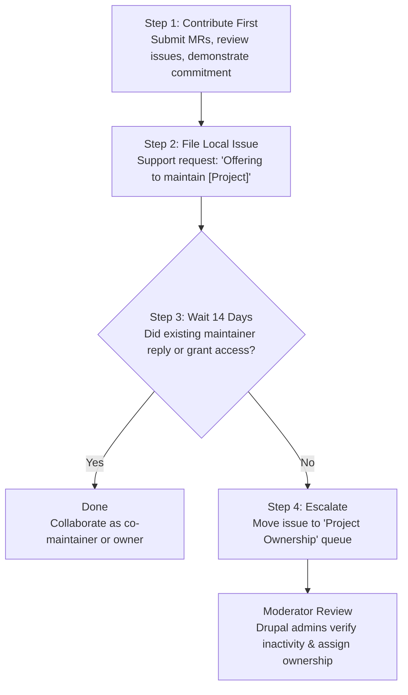

# Drupal Project Governance & Maintainer Workflows

This skill guides Drupal developers and maintainers through project ownership transitions, co-maintainer delegation, project lifecycle states (unsupported/obsolete), and governance tasks on Drupal.org.

---

## 1. Abandoned Project Takeover (14-Day Queue Process)

If a contributed module, theme, or recipe is unmaintained or abandoned, the Drupal Association enforces a transparent, issue-queue-driven ownership transfer policy.



### Step-by-Step Procedure:

#### 1. Establish a Contribution Track Record
Before filing a claim, demonstrate active interest in the project:
- Fix open bugs or port the module to the latest Drupal core (e.g. Drupal 11).
- Submit clean GitLab Merge Requests.
- Review and test existing community patches/MRs.

#### 2. Open an Issue in the Project's Local Queue
Navigate to `https://www.drupal.org/project/issues/<project>` and create an issue:
- **Title**: `Offering to maintain [Project Name]` or `Offering to co-maintain [Project Name]`
- **Category**: `Support request`
- **Status**: `Active`
- **Component**: Miscellaneous

**Issue Description Template**:
```markdown
### Motivation
I am actively using [Project Name] and would like to help maintain it, review open issues, and ensure compatibility with modern Drupal versions (Drupal 10.4 and 11).

### Past Contributions
- [MR !12: Add Drupal 11 compatibility](link)
- [Issue #3456789: Fix entity query access check](link)

I am requesting co-maintainer or maintainer permissions to help keep this project active.
```

#### 3. Observe the Mandatory 14-Day Waiting Period
- You **must wait at least 14 days** after opening the issue.
- This gives current maintainers sufficient time to respond, return from hiatus, or grant permissions.

#### 4. Escalate to the Project Ownership Queue
If 14 days pass with **no response** from any maintainer:
1. Edit your original issue and change the **Project** field to **Project Ownership** (`drupal.org/project/issues/project_ownership`).
2. Add a follow-up comment noting that 14 days have elapsed without a response from the maintainers, and request moderator review.
3. Drupal.org site administrators will verify maintainer inactivity, inspect your qualifications, and assign maintainer permissions.

---

## 2. Managing Co-Maintainers & Delegation

Project owners can delegate specific permissions to collaborators at:  
`https://www.drupal.org/project/<project>/maintainers`

### Available Maintainer Permissions:
- **Maintain issues**: Triage, reassign, and credit issues in the issue queue.
- **Write to VCS**: Push commits and branches directly to `git.drupalcode.org/project/<project>.git`.
- **Administer releases**: Create Git tags and publish release nodes on Drupal.org.
- **Edit project**: Edit project description, screenshots, categorization, and maintainers.

> [!TIP]
> When onboarding a new contributor, grant `Maintain issues` and `Write to VCS` first. Reserve `Administer releases` and `Edit project` until trust is established.

---

## 3. Deprecating or Marking Projects Unsupported

When a project is superseded by core or another module:

### 1. Unsupported Status
- Edit project settings (`/project/<project>/edit`).
- Under **Maintenance status**, set to:
  - `Unsupported`: The project is no longer actively maintained.
  - `Seeking new maintainer`: Maintains visibility for potential takeovers.

### 2. Obsolete Status
- If the project has been fully merged into Drupal Core or replaced:
  - Add an announcement at the top of the project page directing users to the alternative.
  - Publish a final release with a deprecation notice in `hook_requirements()` or `.info.yml`.
  - Mark the project status as `Obsolete`.

---

## 4. Migrating from Legacy Issue Queues to Native GitLab Issues

Projects on Drupal.org can transition from the legacy node queue to native GitLab issues:
1. Navigate to your project settings page on Drupal.org.
2. In the issue tracker options, select **GitLab Issues**.
3. Once enabled:
   - Existing open node issues are locked with a pointer to GitLab.
   - New issues are filed at `git.drupalcode.org/project/<project>/-/issues`.
   - Update `README.md` to point users to the new GitLab issue tracker.
